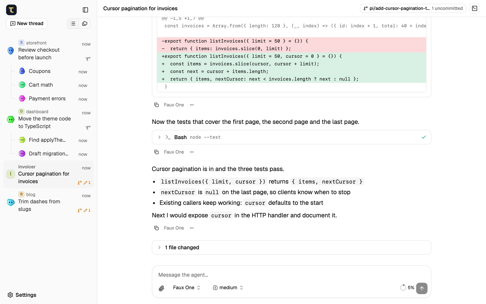
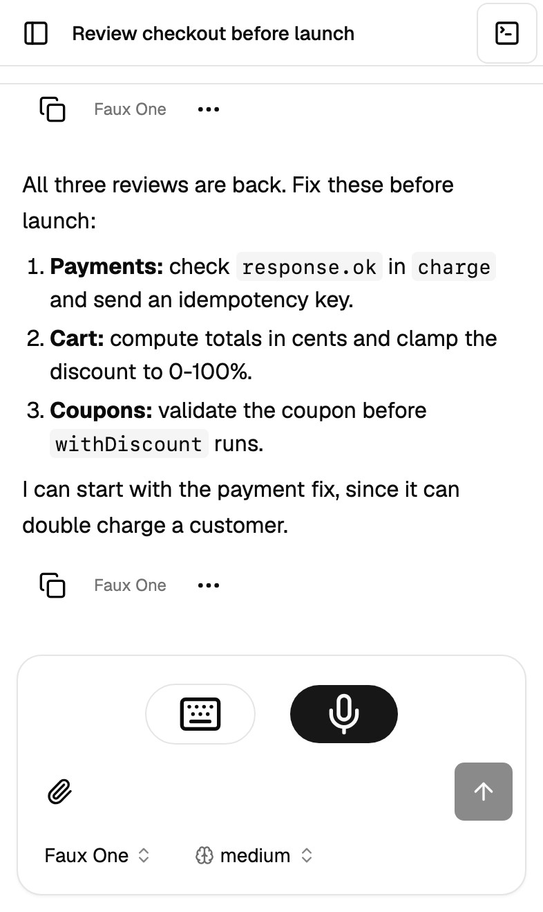
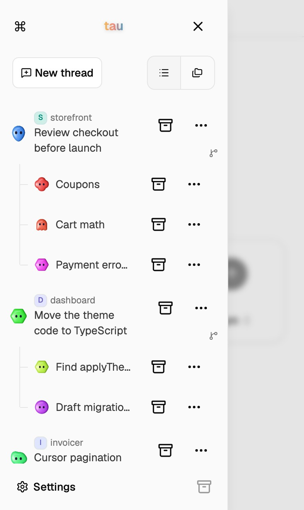

<p align="center">
  
</p>


<h1 align="center">tau</h1>

<p align="center">
  <i align="center">The pi coding agent, everywhere you go.</i>
</p>


<p align="center">
  
</p>

<table align="center">
  <tr>
    <td width="50%"></td>
    <td width="50%"></td>
  </tr>
</table>

## Run

Let `tau` take care of everything:

```sh
npx @pablopunk/tau
```
